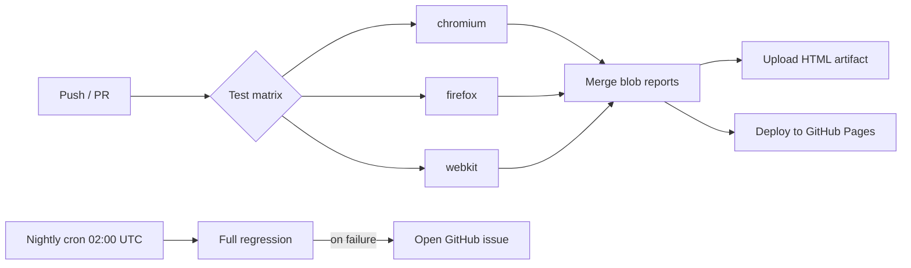

# CI/CD Integration

A **GitHub Actions** showcase demonstrating how automated test execution and reporting fit together into a real continuous-integration pipeline. It runs a small Playwright smoke suite across a **browser matrix**, **merges** the per-browser results into one HTML report, **publishes** that report to **GitHub Pages**, and runs a **scheduled nightly regression** that opens an issue on failure.

The same patterns scale directly to the larger [Playwright](../playwright-automation-framework) and [API](../api-testing-framework) suites in the companion repositories.


## Pipeline at a glance



## Workflows

### `ci.yml` — main pipeline
Triggered on every push and pull request.

1. **`test`** — a matrix runs the suite once per browser (Chromium, Firefox, WebKit). Each shard emits a Playwright **blob** report and uploads it as an artifact.
2. **`report`** — downloads every shard, runs `playwright merge-reports` to produce a single HTML report, uploads it as a build artifact, and (on the default branch) prepares it for Pages.
3. **`deploy`** — publishes the merged report to **GitHub Pages**.

Notable techniques:
- `concurrency` cancels superseded runs on the same branch.
- `fail-fast: false` so one browser failing still lets the others report.
- Least-privilege `permissions` scoped per job; Pages deploy uses OIDC (`id-token: write`).
- `npm` and browser caching for faster runs.

### `nightly.yml` — scheduled regression
- Runs at **02:00 UTC** daily (`schedule: cron`) and on demand (`workflow_dispatch`).
- Executes the full matrix and retains reports for 30 days.
- If anything fails, a follow-up job uses `github-script` to **open a labelled issue** linking to the run.

## Run locally

```bash
npm install
npx playwright install
npm test          # run the smoke suite
npm run report    # open the HTML report
```

To reproduce the CI flow (blob reports + merge) locally:

```bash
npm run test:ci   # emits a blob report
npm run merge     # merges into ./playwright-report
```

## Enabling GitHub Pages (one-time)

1. Push this repository to GitHub.
2. Go to **Settings → Pages**.
3. Under **Build and deployment → Source**, choose **GitHub Actions**.
4. Push to `main`/`master`. After the pipeline runs, the report is available at
   `https://YOUR_USERNAME.github.io/cicd-integration/`.

## Wiring in the other projects

To run the full Playwright or API suites through this same pipeline, point a job at the relevant repository:

- **Playwright UI suite** — copy the `test` → `report` → `deploy` structure from `ci.yml`; it already targets a Playwright project, so only the `testDir`/specs change.
- **API suite** — swap the Node steps for the Java + Maven steps (`actions/setup-java` then `mvn -B test`) and/or the Newman steps shown in that repo's `api-tests.yml`.

A common production setup keeps each suite's workflow in its own repo (as Projects 1 and 2 do) and uses this repo to demonstrate the cross-cutting CI/CD concerns: matrices, report aggregation, scheduling, and publishing.

## Status badges

Add badges to any README by referencing a workflow file:

```markdown

```

> Replace `YOUR_USERNAME` throughout after pushing to GitHub.

## License

MIT
